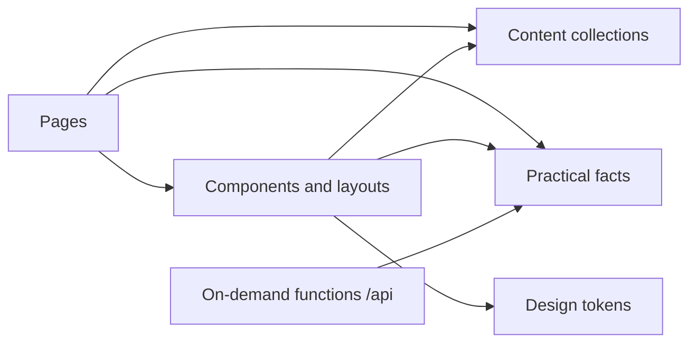
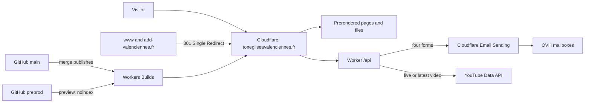
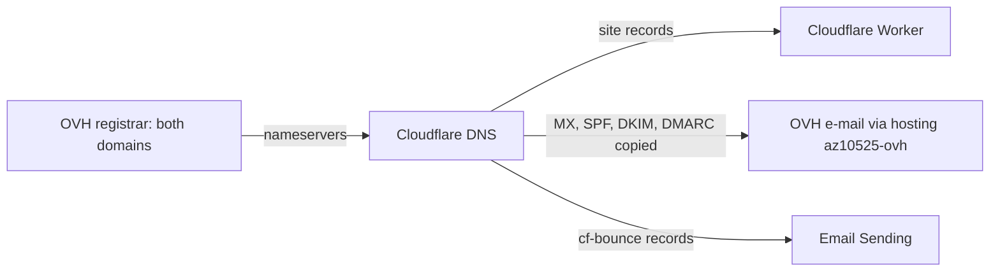

# Architecture Spine — New church website

## Design Paradigm

**Pre-built static site with stateless on-demand functions.** Every page is generated at build time from content files kept in the repository and served as static assets by Cloudflare. Only what must answer at request time runs as code, inside one Cloudflare Worker under `/api/`. There is no database and no visitor data at rest.

| Layer | Lives in | May depend on |
| --- | --- | --- |
| Content | `site/src/content/`, `site/src/assets/` | nothing |
| Practical facts | `site/src/data/facts.json` + its schema | nothing |
| Design tokens | `design/tokens.json` (source) → generated `site/src/styles/tokens.css` | nothing |
| Components and layouts | `site/src/components/`, `site/src/layouts/` | content collections, facts, tokens |
| Pages | `site/src/pages/` | components, layouts, content collections, facts |
| On-demand functions | `site/src/pages/api/` | facts, Worker bindings, variables and secrets |
| Edge config in the repo | `site/wrangler.jsonc`, `site/public/_redirects`, build-generated `_headers` and `robots.txt` | nothing |
| Edge config outside the repo | Cloudflare dashboard, recorded in `site/ops/cloudflare-settings.md` | nothing |



## Invariants & Rules

### AD-1 — Static first, code only under /api [ADOPTED]

- **Binds:** all
- **Prevents:** pages rendered per request, a database, or server state creeping in page by page.
- **Rule:** every route outside `/api/` is prerendered at build; no server islands, no on-demand image service (`imageService: 'compile'`). Code that runs at request time lives only under `/api/`, is stateless, and stores nothing about visitors: no database, no KV, no log of message bodies. Browser scripts call `/api/` with `fetch`.

### AD-2 — One path to production [ADOPTED]

- **Binds:** all, content included
- **Prevents:** production changed outside review, or a second editing channel.
- **Rule:** every change goes task branch → PR to `develop` → `preprod` → `main`, each merge by the owner. Merging to `main` publishes production through Workers Builds. No manual upload. Agents never merge to the three branches. Settings that exist only in the Cloudflare dashboard (DNS, redirect rules, custom domain, build settings, Turnstile, Email Sending onboarding, secrets) are changed by the owner and recorded, names only, in `site/ops/cloudflare-settings.md` through the same flow. In an incident the owner may roll back in the dashboard, then a revert PR follows the same day.

### AD-3 — Content is typed files, read only through collections [ADOPTED]

- **Binds:** all content types, future CMS
- **Prevents:** visitor-facing text hardcoded in templates, two shapes for one content type, a CMS that cannot plug in.
- **Rule:** each content type (page, event, menu) has exactly one schema in `site/src/content.config.ts`. Templates read content only through these collections. Content files contain no `iframe`, `script` or third-party URL in an `src`; the build fails if they do. Images used by content live in `site/src/assets/`. A future CMS either writes these same files or replaces the collection loaders.

### AD-4 — Practical facts have one home [ADOPTED]

- **Binds:** CAP-10, footer, contact page, "Chaque semaine" block, structured data, `.ics` files, legal pages, form e-mails
- **Prevents:** contradictory times, address or contacts across pages.
- **Rule:** church name, address, phone, contact e-mail, pastor couple and the regular weekly meetings live in `site/src/data/facts.json` only, validated by one schema module that pages and `/api` both import. Weekly meetings are never events. Phone, e-mail and address render as `tel:`, `mailto:` and map links.

### AD-5 — Forms send, never store [ADOPTED]

- **Binds:** the four forms: contact, prayer request, interview request, "Servir à l'église" (CAP-5)
- **Prevents:** a form keeping personal or religious data, a second sending channel, tests reaching the church.
- **Rule:** each form posts to `/api/forms/<form-name>`. The function checks Turnstile and a honeypot, validates the fields, sends one e-mail through the Cloudflare Email Sending binding, and returns. Recipients per form live in the `FORM_RECIPIENTS` variable and the sender in `FORM_SENDER`, both in `wrangler.jsonc`. Recipients are today's OVH mailboxes. Nothing is stored. The function mails church recipients only when the request host equals `CANONICAL_HOST`; on any other host it sends to the test address of the preview environment or refuses.

### AD-6 — Sermons come from YouTube at request time [ADOPTED]

- **Binds:** home page, sermons page (CAP-12)
- **Prevents:** a second sermon source, sermon pages to maintain, a weekly manual step, YouTube quota exhaustion.
- **Rule:** the site has no sermon pages. `/api/sermon` reads the channel's uploads playlist (`playlistItems.list`) then `videos.list` (`snippet,liveStreamingDetails`), never `search.list`. It returns `{ ok, kind: "live" | "latest", videoId, title, publishedAt, channelUrl }`, cached with the Cache API for the TTL set in `wrangler.jsonc`; on a YouTube error it serves the last cached value or `{ ok: false }`, and the page then shows only the channel link. One component, `LatestSermon`, renders it on the home page and the sermons page. `/api/sermon/thumbnail` serves only the current `videoId`'s image.

### AD-7 — Nothing third-party before a click [ADOPTED]

- **Binds:** every page and component
- **Prevents:** consent breaches, a cookie banner coming back, slow pages.
- **Rule:** fonts, images, maps and scripts are served from the site's own domain. Analytics is Cloudflare Web Analytics only. Turnstile (form pages only) and the Web Analytics beacon are the only third-party scripts loaded without a click. Every embed goes through one `ConsentEmbed` component: a placeholder warning about the provider's cookies, the player loading on click. Consent is per click and never stored; there is no cookie banner and no consent manager. Maps are a static image on the site with a "Voir le plan" link. Share buttons are plain links, no provider script.

### AD-8 — Events are files, filtered at view time [ADOPTED]

- **Binds:** events page, event pages, home page events block
- **Prevents:** events stored elsewhere, past events shown until the next deploy, a third-party calendar widget.
- **Rule:** one file per event in the `events` collection, with start and end as ISO 8601 with offset, Europe/Paris. Every event has its own page. Lists hide past events in the browser by comparing the end time to the visitor's clock. Past events disappear, no archive; their pages stay reachable but say the event is over. Each event offers "Ajouter à mon agenda" through a `.ics` file generated at build.

### AD-9 — One canonical address, old URLs kept alive [ADOPTED]

- **Binds:** domains, redirects, sitemap, canonical tags
- **Prevents:** duplicate sites under two names, dead links from search engines and bookmarks.
- **Rule:** the site answers only on `CANONICAL_HOST` = `tonegliseavalenciennes.fr`. `www.tonegliseavalenciennes.fr`, `add-valenciennes.fr` and `www.add-valenciennes.fr` get a 301 to the same path there through Cloudflare Single Redirect rules on each zone. Path redirects live only in `site/public/_redirects`. Every URL of the live site is listed once in `site/ops/url-inventory.csv` with its fate: kept, 301 to a target, or 410. Kept pages keep their WordPress path, with a trailing slash. Each old sermon URL redirects to its own YouTube video, or to the sermons page when the video is gone.

### AD-10 — Only production is indexed [ADOPTED]

- **Binds:** environments
- **Prevents:** preprod or a `workers.dev` copy in search results.
- **Rule:** the build derives `SITE_ENV` from the build branch: `production` for `main` only. `robots.txt` and the `X-Robots-Tag` header are generated from `SITE_ENV`; anything else is `noindex` and disallows all robots. Production has `workers_dev` off. `preprod` is a Cloudflare preview with its own variables and secrets, open to anyone with the link.

### AD-11 — Mail keeps flowing through the move [ADOPTED]

- **Binds:** DNS, OVH services
- **Prevents:** losing the church's e-mail during or after the move.
- **Rule:** domains stay registered at OVH. Only DNS moves to Cloudflare, after every OVH mail record (MX, SPF, DKIM, DMARC, autodiscover) is copied identically. Records added for Email Sending merge with existing ones, never duplicate them. The WordPress site stays live on OVH until the switch. The OVH web hosting `az10525-ovh` is not cancelled while the mailboxes depend on it. `jeunessentiel.fr` is out of scope.

### AD-12 — One visual charter, as tokens

- **Binds:** all components (CAP-7, CAP-8, CAP-9)
- **Prevents:** pages drifting from the charter, raw values that fail contrast, mockups overriding architecture.
- **Rule:** `design/tokens.json` is the only source of colours, type scale, spacing and radii; `site/src/styles/tokens.css` is generated from it at build. Components use tokens, never raw values. Components follow the validated mockups of `design/maquettes/` and `design/DESIGN.md`; where a mockup contradicts an AD, the AD wins. Known cases: the sermons list and single-sermon mockups (AD-6), the "Gérer mes choix de cookies" button (AD-7).

### AD-13 — Accessibility is part of done

- **Binds:** every component and page (CAP-7, CAP-8, CAP-13)
- **Prevents:** accessibility fixed after the fact, page by page.
- **Rule:** a component is done only when it meets WCAG 2.1 AA and the phone criteria of CAP-7: skip link, one `h1`, landmarks, named controls, visible focus, 4.5:1 contrast, 44 px targets, 16 px body text, pinch-zoom allowed, reduced motion respected.

### AD-14 — Secrets never in the repository

- **Binds:** all
- **Prevents:** credentials leaking through git.
- **Rule:** API keys (YouTube, Turnstile secret) are Worker secrets set by the owner, separately for production and preview. No secret, and no value from the old `wp-config.php`, appears in a tracked file.

### AD-15 — No new paid service [ADOPTED]

- **Binds:** all
- **Prevents:** recurring costs creeping in.
- **Rule:** the site runs on the existing Cloudflare Workers Paid plan, the OVH domains and OVH e-mail. Any other paid service, or any paid option of these, needs the owner's approval first.

### AD-16 — Old content is imported once, from production

- **Binds:** content migration
- **Prevents:** content taken from the stale March 2026 backup, texts rewritten during the move, two import methods.
- **Rule:** one script, run once, pulls texts and photos from the live site into the content collections and `site/src/assets/`, and builds `url-inventory.csv` and the sermon redirects. Kept texts and photos are copied as they are, corrected only where `design/DESIGN.md` records a change. The script is removed after the switch.

## Consistency Conventions

| Concern | Convention |
| --- | --- |
| Language | Visitor-facing text in French, addressing the visitor as "tu" (legal pages excepted). Code, comments, file names, commits in English. |
| File names | kebab-case; event files `YYYY-MM-DD-slug.md`. |
| URLs | Lowercase, French slugs, trailing slash (`trailingSlash: 'always'`). |
| Dates and times | ISO 8601 with offset in data; Europe/Paris; displayed in French with the full date and year. |
| API responses | JSON. Success `{ "ok": true, ... }`; failure `{ "ok": false, "error": "<code>" }` with the matching HTTP status, codes from one shared list. Visitor-facing messages live in the page, not the API. |
| API headers | Set in code by one shared helper, since `_headers` does not apply to Worker responses. |
| Logging | Workers Logs may record route, status and error code, never form contents or visitor identifiers. |
| Config | Non-secret settings and variables in `wrangler.jsonc`, with a `previews` block for preview values; secrets via Cloudflare; facts in `facts.json`. |
| Node version | Pinned in `site/.nvmrc`. |

## Stack

| Name | Version |
| --- | --- |
| Node.js | 24 LTS |
| Astro | 7.4.2 |
| @astrojs/cloudflare | 14.4.2 |
| Wrangler | 4.153.0 |
| Cloudflare Workers with Static Assets, Workers Builds, Previews | Workers Paid plan (existing) |
| Cloudflare Email Sending | beta, 3,000 e-mails a month included |
| Cloudflare Turnstile | free |
| Cloudflare Web Analytics | free |
| YouTube Data API | v3 |

## Structural Seed





```text
site/
  .nvmrc
  astro.config.mjs
  wrangler.jsonc
  ops/
    cloudflare-settings.md   # dashboard-only settings, names only
    url-inventory.csv        # every old URL and its fate
  public/                    # _redirects, fonts, favicon, RIB PDF
  scripts/                   # one-time import, removed after the switch
  src/
    content.config.ts
    content/                 # pages, events, menus
    assets/                  # images, resized at build
    data/facts.json
    styles/tokens.css        # generated from design/tokens.json
    components/
    layouts/
    pages/                   # prerendered routes
      api/                   # forms, sermon, sermon thumbnail
```

## Capability → Architecture Map

| Capability / Area | Lives in | Governed by |
| --- | --- | --- |
| CAP-3 Closed server exposure | Cloudflare, generated headers | AD-1, AD-10, AD-14 |
| CAP-5 Personal data | `/api/forms`, legal pages | AD-5, AD-7 |
| CAP-6 Lighter pages | build, image pipeline | AD-1, AD-7 |
| CAP-7, CAP-8, CAP-9 Phone, colours, one charter | tokens, components | AD-12, AD-13 |
| CAP-10 Practical facts | `facts.json` | AD-4 |
| CAP-11 No dead ends | content, redirects | AD-3, AD-9, AD-16 |
| CAP-12 Sermons | `/api/sermon`, `LatestSermon` | AD-6, AD-7, AD-9 |
| CAP-13 Keyboard and screen reader | components | AD-13 |
| Events | `events` collection | AD-8 |
| Domains, e-mail, environments, operations | Cloudflare DNS and rules, Workers Builds | AD-2, AD-9, AD-10, AD-11 |
| CAP-1, CAP-2, CAP-4, CAP-14 (WordPress upkeep) | superseded by leaving WordPress | — |

## Deferred

- **CMS choice** (git-based or headless): when the owner knows who will edit. AD-3 keeps both open.
- **Switch-over checklist** (order of DNS move, checks, rollback): written by the domains and hosting epic, within AD-2, AD-9 and AD-11.
- **OVH hosting versus a standalone e-mail offer**: after the switch, once OVH confirms where the mailboxes live.
- **Fallback if Email Sending (beta) fails**: another sender only with the owner's approval (AD-15).
- **Removal of `web/`**: a separate task the owner approves.
- **Update of `AGENTS.md`** (merging to `main` now publishes; WordPress left): a task of the first epic.
- **Form fields and texts, legal pages wording**: page-level, following the mockups and AD-7.
- **Site search, newcomer page, online giving**: not in the current structure.
- **Monitoring beyond Workers Logs and Web Analytics**: not needed at this size.

## Open Questions

- Which OVH mailbox receives each of today's forms? Read from the current WordPress form settings.
- Does an existing `_dmarc` record at OVH need merging with the one Email Sending adds, and does onboarding leave the root MX untouched?
- Does the `send_email` binding work in Cloudflare Previews? If not, preview forms refuse with a test message.
- Does a live broadcast appear in the uploads playlist while it is live? Check when building `/api/sermon`.
- Does Cloudflare Web Analytics set no cookie in practice? Check in the browser before the privacy page says so.
- Who reads prayer and interview requests in the mailbox, and how long are they kept there?
- Is the payment method at OVH valid for the renewal of `tonegliseavalenciennes.fr` on 17/12/2026?
